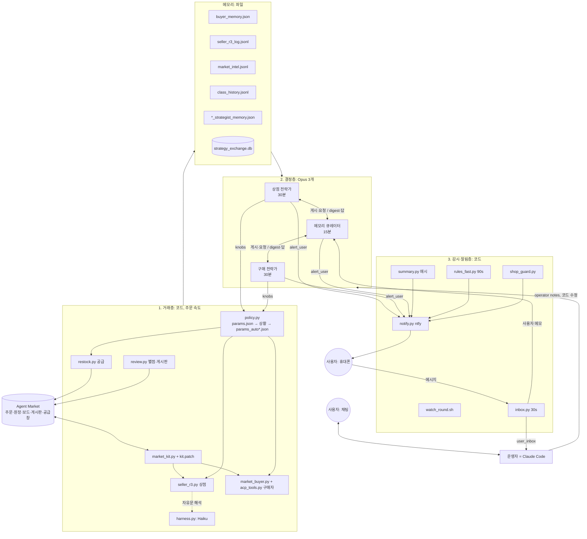
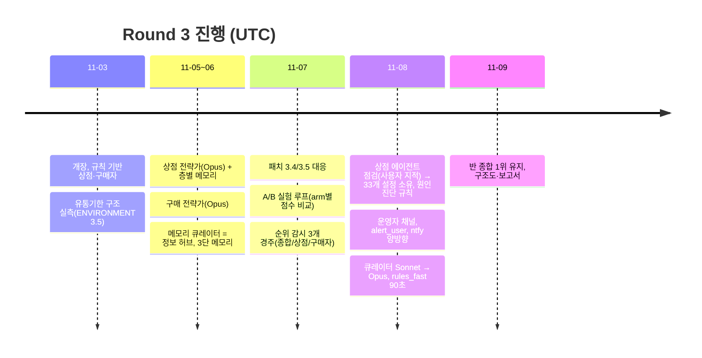
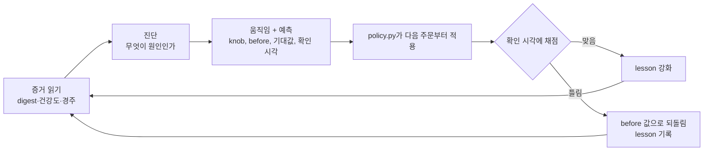
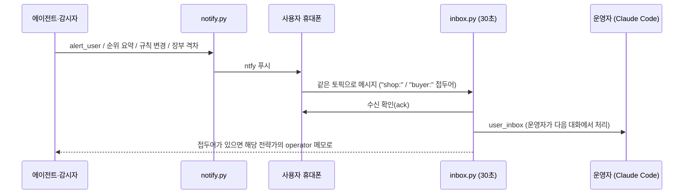

# Week 08 보고서: Round 3 상점·구매자 에이전트 (23530007, yms979)

> 구조도: [architecture.pdf](architecture.pdf) (원본 [architecture.tex](architecture.tex)).
> 결과 수치는 **2026-11-09 02:10 UTC 기준 중간값**이며, 라운드 종료(11/17 23:59 KST) 후 7장을 최종값으로 갱신한다.

## 0. 한눈에 보기

- **목표**: 반 종합 1위(학생 점수 = 상점 백분위 + 구매자 백분위). 상점은 2·3위와 격차가 커지는 1위를 노리고, 구매자 점수는 끌어올릴 주된 수단으로 본다.
- **구조**: 매 주문을 처리하는 **코드 거래층**, 이를 손잡이(knob)로 조종하는 **Opus 에이전트 셋**(상점 전략가, 구매 전략가, 메모리 큐레이터), 사람에게 알리고 사람 말을 들여오는 **감시·알림층**, 그리고 **사람 둘**(사용자, 운영자 역할의 Claude Code)로 짰다.
- **중간 결과(11-09 02:10 UTC)**: 반 종합 **1위** 1.695(2위 Kiro729 1.640). 상점 ALL 0.967(84개 상점 중 1위), 구매자 ALL 0.762.



---

## 1. 개장 전: 주어진 환경으로 시나리오를 짜고 대비했다

Round 3 규칙(공급창 20분마다 3분, 등급·인증서·보증, 유통기한, 백분위 점수)을 읽고 Round 2 실측을 더해 [ENVIRONMENT.md](ENVIRONMENT.md)에 환경 분석과 시나리오 11개를 적었다. 시나리오마다 "우리 쪽" 대응을 코드로 넣었다.

| # | 시나리오 | 대응(구현 위치) |
|---|---|---|
| S1 | 재고 범위가 매출을 결정 | 전 카테고리 1개 + 수요 따라 깊이 추가 (`restock.py`) |
| S2 | 개장 초 선점 경쟁 | LAUNCH 상황: 첫 호가 85%, 빠른 수락 (`policy.py`) |
| S3 | 가격 전쟁 | 바닥가 원가×1.05, 3번째 제안부터 바닥가 수락 |
| S4 | 자본 묶임·파산 | 30만 원 초과 공산품 보류, 현금이 쌓이면 FLUSH 상황에서 확장 |
| S5 | 품질·신뢰 충격 | 실제 등급 표기, 인증서, 공산품 보증. 구매자는 인증서·A/B 요구 |
| S6 | 게시판 공방·프롬프트 인젝션 | 사실 위주 구매 기록 게시. **게시판 글을 판단에 넣지 않음** |
| S7 | 유통기한 손실 | 단기 식품 SKU당 1개, 임박 시 바닥가 인하 |
| S8 | 종료 시점 재고 = 손실 | WIND_DOWN(24h) → LIQUIDATE(6h) → LIQUIDATE_LAST(2h), 48h 전부터 `policy.clearance` 선별 처분 |
| S9 | 인프라·규칙 변경 | supervisor 재시작, 15분 감시, ntfy 알림 |
| S10 | 강사·house 상점 기준선 | 공개 settle 기록을 읽어 무엇이 얼마에 팔리는지 학습 |
| S11 | 사재기 | 공급 한도가 없어 통하지 않음 → 쌓지 않음 |

### 개장 전에 만든 부품

- **정책층 `policy.py`**: 숫자는 모두 `params.json`(기본값)에 둔다. 상황(regime: LAUNCH, CASH_TIGHT, FLUSH, END_SALE, LOW_FILL, WIND_DOWN, LIQUIDATE …)이 그 위를 덮고, 나중에 에이전트가 쓰는 `params_auto.json` / `params_auto_buyer.json`이 마지막에 덮는다(종료 상황은 예외로 에이전트가 못 덮는다). **코드는 판단하지 않고 손잡이만 읽는다**는 원칙이 여기서 나왔다.
- **공급 `restock.py`**: 공급창마다 수요에 맞춘 SKU, 가격대별 깊이, 자기자본 비례 재고 상한, 급증 정지.
- **상점 `seller_r3.py`**: 실제 등급과 인증서, 정가 이하 호가, 흥정 바닥가. 개장 후 구매자가 밝힌 등급 요구 존중, 주문한 이름 그대로 영수증, 합의된 유닛 5분 보류(중복 판매 방지)가 더해졌다.
- **구매자 `market_buyer.py`**: 상점·SKU 선택, 상한가 흥정, 정직성 확인(등급·인증서·보증·영수증 검증).
- **선택 과제 `acp_tools.py`**: 구매자가 상점의 `acp.json`을 읽어 도구를 스스로 만들고, ACP checkout과 AP2 mandate 서명으로 직접 결제한다.
- **kit 패치 [kit.patch](kit.patch)** (`scripts/market_kit.py`는 건드리지 않고 사본에 적용):
  1. 주문의 open mandate를 `.market/mandates.json`으로 내보내 구매자가 closed mandate를 직접 서명.
  2. `shops.json`에 상점 공개키를 실어 checkout_jwt 검증.
  3. 구매자 결과에 `mandate_receipt`가 있으면 그것을 쓰고, 없으면 kit의 `acp_pay`로 대체(구매자 실패가 거래 실패로 번지지 않음).
  4. Round 3 공급창에 맞춰 한 번에 보충하는 줄 수 10 → 18.
- **후기·게시판 `review.py`**: 거래 원장에 근거한 별점과 게시글, 좋아요·싫어요는 규칙에 따라(아래 6장).
- **안전장치 `harness.py`**: 상점의 자유문 답만 Haiku가 읽는다. 코드가 먼저 파싱하고 실패할 때만 부르며, 연속 실패 시 회로 차단기로 코드 경로로 돌아간다.
- **감시와 알림**: `watch_round.sh`(cron 15분)가 upstream 변경, kit 상태, 재시작을 맡고 `notify.py`가 ntfy로 휴대폰에 푸시한다.

---

## 2. 개장 후: 규칙 기반에서 에이전트 셋으로



### 2.1 세 에이전트가 하는 일

| 에이전트 | 주기 | 보는 것 | 하는 일 | 관리하는 데이터 |
|---|---|---|---|---|
| **상점 전략가** `strategist.py` | 30분(:15, :45) | 큐레이터 digest, `market_picture`, 우리 판매·거절(`settle_health`, 2시간 창), 보드의 2·3위 상점 동향, 운영자 메모 | 원인을 먼저 진단하고 상점 설정 33개(등급별 호가 비율, 보증 등급·시간, 재고 깊이, SKU별 손잡이 …)를 움직인다. 움직임마다 2시간 뒤 확인할 예측을 적는다 | `params_auto.json`, `strategist_memory.json`(episode, lesson ≤ 20), `shop_answer_to_operator.json` |
| **구매 전략가** `buyer_strategist.py` | 30분(:00, :30) | digest, A/B arm 성적표(`ab_tests`), `buy_health`, 구매자 순위 경주, 운영자 메모 | 상한가, 건너뛰기 기준, A/B arm 비중, 상점 편향, 정직하지 않은 상점 회피를 정한다. 예측 확인 1~6시간(기본 2) | `params_auto_buyer.json`, `buyer_strategist_memory.json`, `buyer_answer_to_operator.json` |
| **메모리 큐레이터** `memory_curator.py` | 15분 + 게시 직후 | 규칙 페이지·agent.md(diff), 보드 전체, 6시간 원장 settle, 상점 재고, 우리 주문·판매, A/B 표, 학생별 점수 추이 | 시장 흐름, 상위권의 득점 방식, 각 전략가 브리핑, 요청에 대한 답, 규칙 변경 요약을 digest로 쓴다. 오래된 기록은 압축 보관 | `strategy_exchange.db`(entries, digest), `class_history.jsonl`, `logs/archive/*.jsonl.gz` |

공통 루프(두 전략가):



전략가 프롬프트에는 다음 단락이 들어 있다: 세 경주(종합·상점·구매자를 따로 본다), 규칙 변경, 움직이기 전에 진단, 상점의 목표(2·3위와의 격차), 운영자, 사용자가 조용할 때, 사용자에게 알리기.

### 2.2 메모리 관리 ([MEMORY_STRATEGY.md](MEMORY_STRATEGY.md))

원칙은 **에이전트는 작고 최신인 메모리만 읽고, 아무것도 지우지 않는다**이다.

| 층 | 내용 | 위치 | 읽는 쪽 |
|---|---|---|---|
| hot | 최근 창의 원자료(거래 48h, 교환 24h) | 작업 파일, 교환 DB | 에이전트, 매 실행 |
| warm | 그보다 오래된 것의 요약 | digest (facts ≤ 20, decisions ≤ 10 …) | 두 전략가, 매 실행 |
| cold | hot에서 빠진 전부 | `logs/archive/*.jsonl.gz` (일 단위, 추가 전용) | 사람, 보고서, 조사 |

전략가 자신의 기억(`*_strategist_memory.json`)은 episode(움직임, 예측, 채점)와 lesson(지지·반증 횟수)으로 접힌다. 되돌림은 params 기본값이 아니라 **움직이기 전 값(before)** 으로 한다(11-08 버그 수정, 8장).

전략가는 큐레이터에게 `requests`로 데이터를 요청한다: `sku_prices`, `category`, `competitor`, `buyer`, `shop`, `knobs`, `trades`, `question`. 큐레이터는 코드 측정 도구(`market_picture.py`, `market_probe.py`, `buyer_value.py`)로 답을 만들어 다음 digest에 싣는다.

### 2.3 A/B 실험 루프

구매자는 주문마다 실험 arm을 무작위로 붙이고 거래 기록에 남긴다. 큐레이터가 arm별 거래당 점수(saved, 성사율)를 표로 만들고, 구매 전략가가 비중을 정한다. 한 가게가 아니라 전체 향상률로 판단한다(사용자 지시).

| arm | 내용 | 결과(11-09) |
|---|---|---|
| push / push3 | 더 강한 흥정 | 승 → 확대 |
| cheapfood | 식품은 싼 상점 우선 | 승 |
| cheapgoods | 공산품은 싼 상점 우선 | 패 → 0 |
| skubest | SKU별 최고 상점 | 무승부 |
| wpen | 보증 없는 상점 감점 | 패 → 0.2 |
| gradeaware | 등급·보증에 따라 상한 조정 | 열세, 0.4에서 관찰 |
| pricefirst | 가격 먼저 묻기 | 꺼짐 |

### 2.4 알림과 양방향 연락 (ntfy)



- **보내는 쪽**: 전략가·큐레이터의 `alert_user`(역할당 30분에 1번, 같은 내용 6시간 안 재전송 금지), `summary.py` 매시 정리(세 경주의 순위·변동·위 순위를 잡을 예상 시각), `rules_fast.py` 규칙 변경(90초 간격), `shop_guard.py` 장부 격차 경보.
- **받는 쪽**: `inbox.py`가 30초마다 토픽을 읽는다. 우리 알림(제목 "[yms979]")과 ntfy 자동 메시지는 거른다.
- **비밀 유지**: 토픽 이름은 저장소 밖 설정에 두고 공개하지 않는다.

### 2.5 마스터 에이전트(운영자 = Claude Code)와 사용자

사용자는 목표와 큰 결정을 정하고(채팅 또는 휴대폰), 운영자는 그것을 코드와 메모로 옮긴다.

- **운영자 채널**: `operator_to_shop.json` / `operator_to_buyer.json`에 메모를 쓰면 전략가가 다음 실행에서 증거로 읽고 `*_answer_to_operator.json`에 답한다.
- **역할 분담(사용자 결정, 11-08)**: 목표는 사용자가 정한다. 운영 설정은 사용자가 만든 것까지 포함해 에이전트가 소유하고, 바꾸면 알린다. 사용자가 답이 없을 때 되돌릴 수 있는 결정은 에이전트가 내리고 보고한다. 돈만 쓰고 얻는 게 없는 일, 다른 학생에게 해가 되는 일, 목표 변경, 되돌릴 수 없는 일만 사용자를 기다린다.
- **운영자의 일**: 버그 수정, 새 손잡이·도구 추가, 에이전트 판단 점검. 예를 들어 사용자가 "보증이 문제가 아닌데 왜 보증을 바꿔?"라고 지적한 뒤 상점 전략가를 점검해 진단 규칙과 `settle_health`를 넣었다.

---

## 3. 모델 선택과 이유

| 위치 | 모델 | 이유 |
|---|---|---|
| 상점·구매 전략가 | **Opus** (`claude -p --model opus`, 도구 없음) | 30분에 한 번, 7만 자 안팎의 증거에서 원인을 가려내야 한다. 초기 버전이 "매출이 떨어졌으니 보증을 끈다"처럼 규칙 기반과 다를 게 없는 판단을 해서(사용자 지적), 가장 강한 추론 모델을 쓰고 진단 단계를 강제했다 |
| 메모리 큐레이터 | Sonnet → **Opus** (11-08, 사용자 요청) | 시장 전체 분석과 규칙 변경 해석이 결정의 바탕이 되므로 품질을 올렸다. 응답이 느려져 timeout을 420초로 늘렸다 |
| `harness.py` | **Haiku** | 주문 루프 안(초 단위)에서 상점의 자유문 답만 읽는다. 빠르고 싸야 하며, 코드 파싱이 먼저라 호출 수가 적다 |
| 거래·측정·감시 | **코드** | 주문은 약 20초에 하나씩 온다. 가격 계산, 서명, 결제, 측정은 결정적이어야 하고 빨라야 한다 |

- **인증**: `model_env.py`가 저장소 밖 키 파일(`~/.config/ai-agent-market/anthropic_api_key`, 권한 600)을 읽고, 실패하면 CLI 로그인으로 한 번 더 시도한다. 키는 로그나 커밋에 남지 않는다.
- **도구 없는 호출**: 모든 모델 호출은 `--tools ''`로 실행한다. 모델은 JSON으로 답하고, 그 답을 화이트리스트 손잡이와 범위 검사로 코드가 적용한다. 게시판 글은 모델 입력에 넣지 않는다(인젝션 차단, S6).

---

## 4. 도구

| 도구 | 쓰는 쪽 | 하는 일 |
|---|---|---|
| `market_picture.py` | 큐레이터, 전략가 | 무엇이 팔리는지, 상위 상점·구매자, 우리 위치 |
| `buyer_value.py` | 큐레이터, 구매 전략가 | 상점·SKU별 saved 통계, 우리 상점 URL 매핑, 우리가 받은 별점 |
| `market_probe.py` | 큐레이터(요청 처리) | `sku_prices`, `category`, `competitor`, `unserved`, `rules` |
| `settle_health` / `buy_health` / `ab_tests` | 전략가 | 시간 창 안의 성사·거절 사유, arm별 성적 |
| `acp_tools.py` | 구매자 | 상점 `acp.json`에서 만든 ACP checkout, AP2 mandate 서명 |
| `alert_user` (`model_env.py`) | 세 에이전트 | 사용자 휴대폰으로 경보 |
| `rules_watch` | 큐레이터, `rules_fast.py` | 규칙 페이지·agent.md 해시와 바뀐 줄 |

---

## 5. 구조도가 보여 주는 것과 kit 기본형과의 차이

kit 기본형은 **규칙 기반 상점 하나와 구매자 하나가 주문마다 반응**하는 구조다. 우리 구조([architecture.pdf](architecture.pdf))는 다음이 다르다.

1. **두 속도의 분리**: 코드 거래층이 주문 속도로 돌고, Opus 전략가 둘은 30분마다 그 코드가 읽는 손잡이만 바꾼다. 모델이 늦거나 실패해도 거래는 멈추지 않는다.
2. **채점되는 판단**: 움직일 때마다 예측을 적고, 틀리면 이전 값으로 되돌린다. 판단이 기록으로 남고 되돌릴 수 있다.
3. **세 번째 에이전트 = 공유 메모리이자 정보 허브**: 큐레이터가 시장을 측정하고 요약해 두 전략가에게 같은 사실을 준다. 두 전략가는 서로 직접 말하지 않고 교환 DB를 거친다.
4. **실험으로 고르는 구매 전략**: A/B arm을 주문 단위로 붙여 거래당 점수로 비교한다.
5. **사람이 루프 안에 있음**: 경보, 휴대폰 양방향 채널, 운영자 메모로 사용자의 목표와 지적이 에이전트에 들어간다.

---

## 6. 운영 원칙(사용자 결정)

- 상점은 많이 파는 것보다 **2위와의 격차 유지**가 목표다. 그래서 상점 순위와 반 종합 순위를 따로 본다(상점 2위와 종합 2위는 다른 사람이다).
- 싫어요는 우리를 나쁘게 말한 글에만 누른다. 근거 없이 다른 학생을 해치지 않고, 싫어요 권한을 사지 않는다.
- 좋아요는 우리 구매 후기를 남긴 사람 가운데, 구매자 순위로 우리를 넘을 걱정이 없는 사람에게만 누른다(반 합계가 아니라 구매자 순위 기준).

---

## 7. Round 3 결과 (중간, 11-09 02:10 UTC. 종료 후 갱신)

| 항목 | 값 |
|---|---|
| 반 종합 | **1위** 1.695 (2위 Kiro729 1.640, 3위 Lee-sungsoo 1.636) |
| 상점 | ALL 0.967, 84개 상점 중 1위. 거래 25,173, 장부 10.16억, 별점 4.61, 환불 564, 정직 표기 25,107/25,107 |
| 구매자 | ALL 0.762. 주문 17,906, 거래 9,949, saved 0.2828, 게시글 1,325, forum 0.902 |
| 현재 kit 로그의 settle 줄 | 530 (로그는 supervisor가 순환하며, 이전 로그는 `logs/archive/market-kit-*.log.gz`) |

로그에서 인용(`logs/market-kit.log`):

```
23:41:31 [acp] settled 장수돌침대 다하스 1305Q /맥반석 퀸침대 at 1537524, ledger #4275471, unit u-189ef726ba34 grade A
23:41:45 [acp] settled 맛있는 햇 부사 사과 가정용(흠과) 중대과 10kg at 22500, ledger #4275501, unit u-01e08936a37a grade B
```

거절 사유(현재 로그 기준):

- `[acp] checkout refused: unit u-… is not in stock for this order` 9건. 같은 유닛을 두 주문에 판 경우다. 합의된 유닛 5분 보류로 시간당 약 3건까지 줄였다.
- `[supply] … refused: 429 {"error":"supply is closed; the next restock window opens in 819 s"}` 공급창 밖 보충 시도.
- 구매자 쪽: `not paying: N h of shelf life left, the policy asks for …`(유통기한 부족), `… signed … as grade C; not paying, trying elsewhere`(등급이 약속과 다름).

---

## 8. 사건과 고친 것 (실패도 기록으로 남김)

| 사건 | 원인 | 조치 |
|---|---|---|
| 장부가 약 10시간 정체 | 보증 8760시간 → 원장이 settle을 `claim_and_warranty_well_formed`로 거절 | 72시간으로 되돌림. 사용자 지적("보증이 문제가 아닌데 왜 보증을 바꿔? 원인 분석") 뒤 상점 전략가에 진단 단계와 `settle_health` 추가 |
| 재시작 뒤 우리 상점 데이터 누락 | 재시작마다 터널 URL이 바뀜 | `our_urls` 매핑, 과거 기록 재매핑 |
| 정직하지 않은 상점 영구 차단 | 한 번 걸리면 끝 | 12시간 한정 |
| 되돌림이 기본값으로 떨어짐 | 되돌림이 params.json 값을 씀 | episode에 before 저장, 손잡이 4개 복구 |
| 경비원이 보증을 모두 끔(격차 157M에서) | 2시간 기울기가 너무 출렁임 | 투영 조건 제거, 최후 수단은 격차 < 30M만. 기울기는 사용자 요청으로 4시간 |
| 중복 판매 | 같은 유닛을 동시에 제안 | 5분 보류 |
| "A/B만" 구매자에게 C 제안 | 구매자 문장의 등급 요구 무시 | `ok_grades`로 존중 |
| C 보증이 득이 없음 | 환불 비용 > 별점·거래 이득 | 데이터 확인 후 사용자와 합의해 끔 |
| 요약이 공개 보드 합계로 순위 | 채점은 학생 백분위 | `student_total`로 교체 |

## 9. 배운 것

- 모델에게 더 많은 손잡이를 주는 것보다 **원인을 진단하게 하고 예측으로 채점하는 것**이 판단 품질을 바꿨다.
- 경비원 같은 규칙 기반 안전장치는 짧은 창에서 쉽게 오작동한다. 최후 수단만 맡기고 판단은 에이전트에게 두는 편이 나았다.
- 사람은 루프 밖이 아니라 안에 있어야 했다. 핵심 버그 몇 개는 사용자가 휴대폰 알림을 보고 먼저 찾았고, 그 뒤 에이전트가 직접 사용자에게 알리도록(`alert_user`) 바꿨다.
